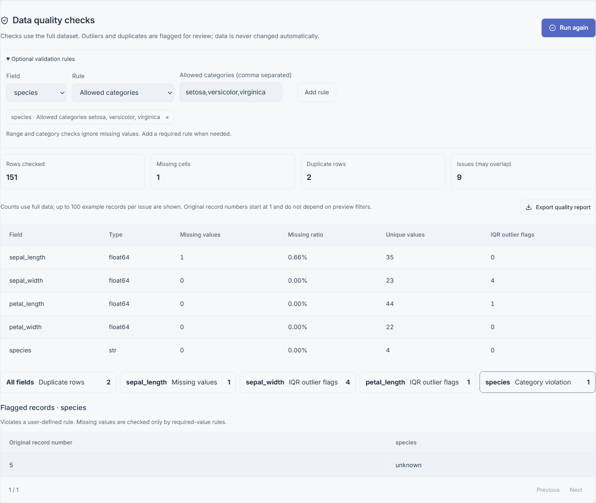
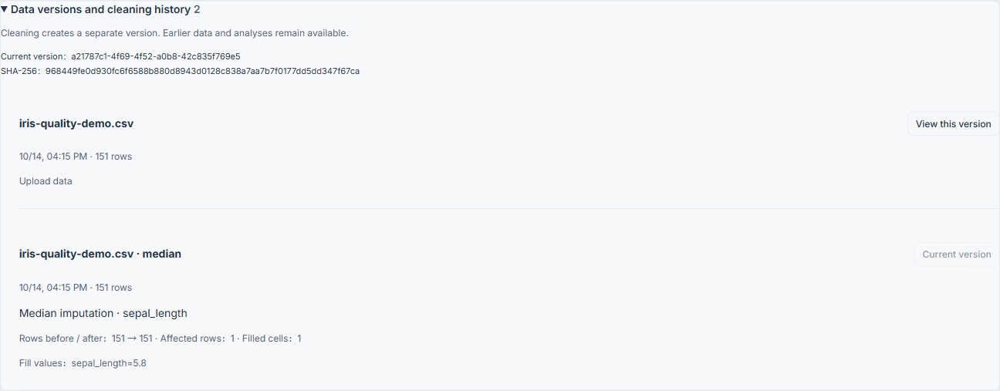
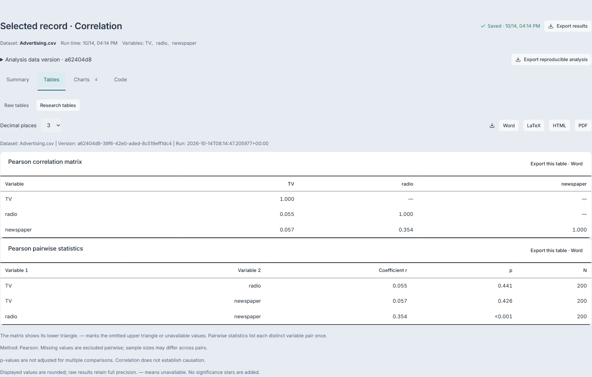
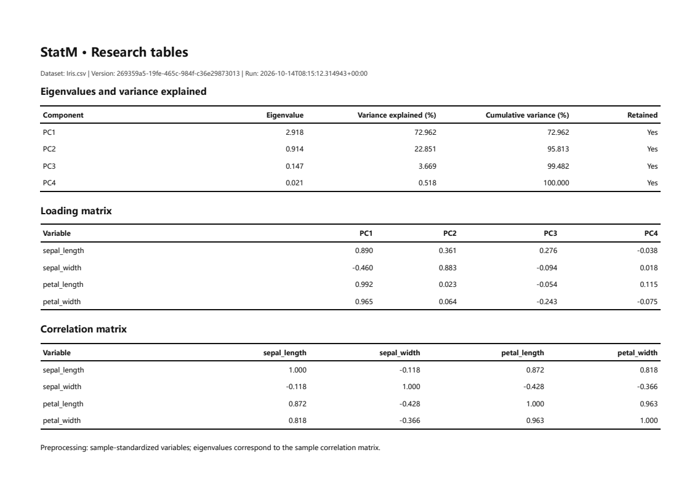
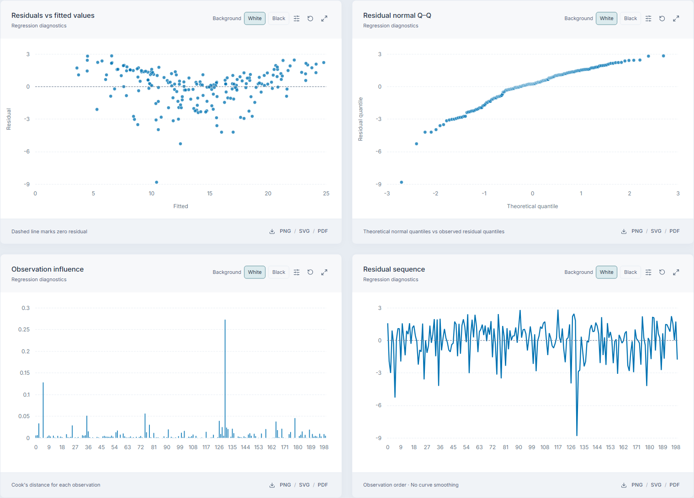
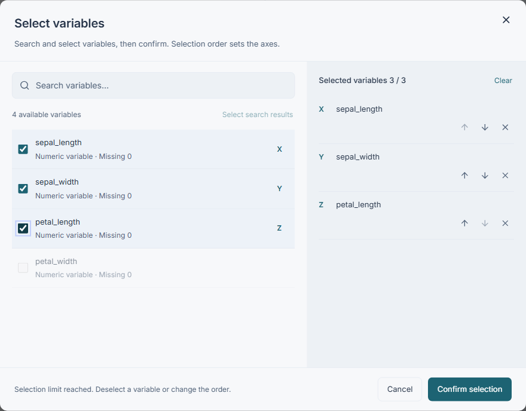
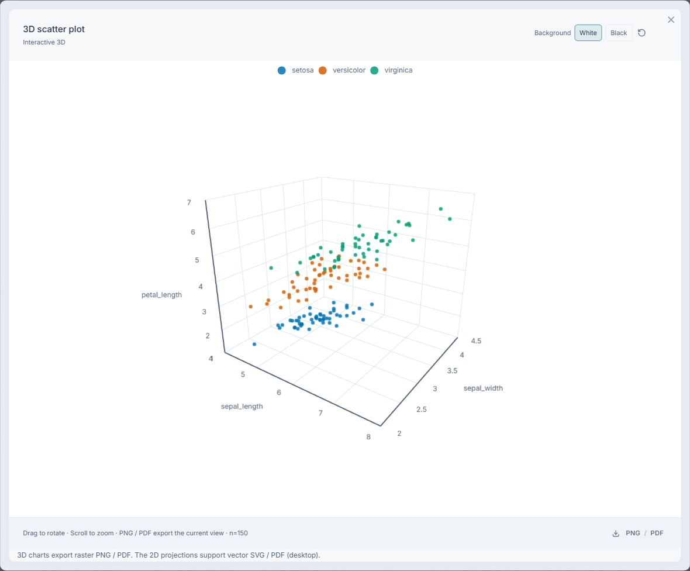
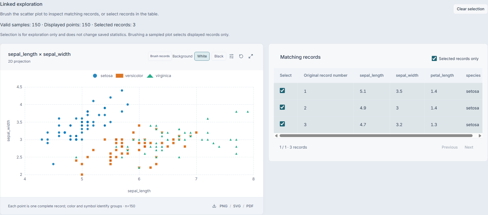
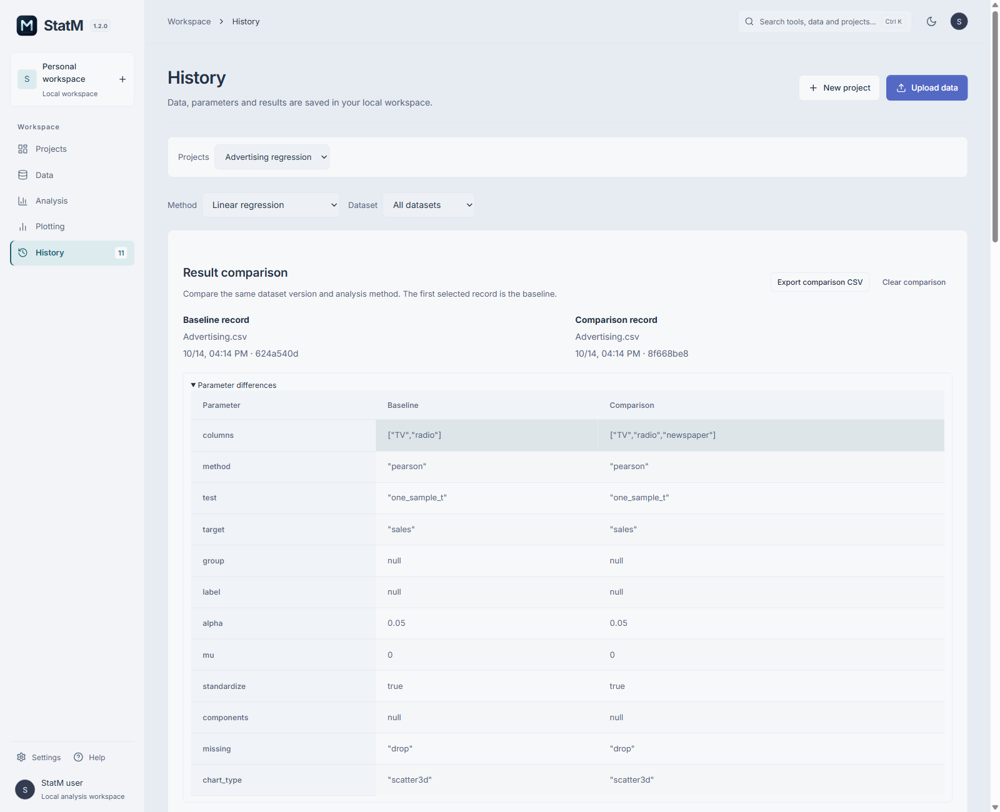
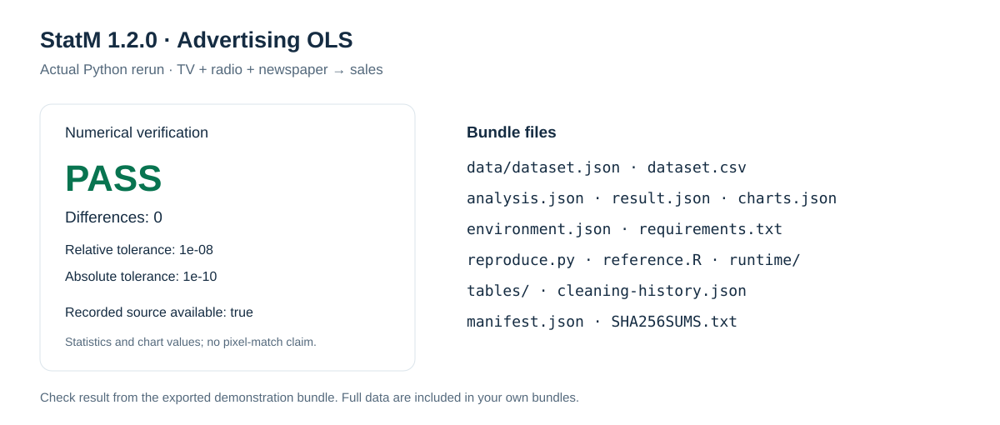

# StatM worked examples

[中文](EXAMPLES.md) · English

[Download](https://github.com/Lewis-18/StatM/releases/latest) · [User guide](USER-GUIDE.en.md) · [Overview](README.en.md) · [Sample files](samples/README.en.md)

These workflows and screenshots use **StatM 1.2.0**. Advertising has 200 observations and Iris has 150; open either from the app homepage. The data-quality tutorial deliberately modifies a copy of Iris. Its issues are not claims about the original data.

*Interface screenshots show a local 1.2.0 documentation preview with English-label corrections. The current 1.2.0 installer may still display some Chinese labels. Main examples use the light app theme and white plot backgrounds.*

## Data quality and cleaning versions

1. Download [iris-quality-demo.csv](samples/iris-quality-demo.csv), create a project and import it.
2. Open **Data → Quality**, expand the rules and allow only setosa, versicolor and virginica for species. Run the checks.
3. Inspect missing values, duplicate rows and IQR flags across the complete dataset. Select the species category issue to locate unknown at original record 5.
4. Export the report. In **Cleaning**, choose only sepal_length and use median imputation, saving an independent version.
5. Expand dataset lineage to inspect the parent version, fill value and affected counts. Use **View this version** to return to the original dataset.

*The teaching dataset has 151 rows. Original record 1 has an empty sepal_length, record 5 has species unknown, record 26 has petal_length 20, and original record 150 is appended. The report has one missing cell, two duplicate rows and one category violation. The bundled source copy already has one duplicate row; the tutorial appends one more. Consult the actual report for IQR counts; issue types may overlap.*

Checks do not automatically remove or impute data. Interpret IQR flags in context. Returning to an earlier version does not delete its descendants.

## Research tables

**Advertising correlation**

1. Open Advertising and select **Analysis → Correlation**.
2. Select TV, radio and newspaper; leave Pearson selected and run.
3. Open **Tables → Research tables**, choose decimal places, and inspect the lower-triangular correlation matrix and pairwise statistics.
4. Export Word, LaTeX, HTML or PDF.

[Sample Word](samples/advertising-correlation.docx) · [LaTeX](samples/advertising-correlation.tex) · [HTML](samples/advertising-correlation.html) · [PDF](samples/advertising-correlation.pdf)

**Iris PCA**

Open Iris, select sepal_length, sepal_width, petal_length and petal_width, and run PCA with standardization enabled. Review eigenvalues, variance explained, cumulative variance, loadings and the correlation matrix. Retain the table notes that define preprocessing and loadings.

[English Word](samples/iris-pca-en.docx) · [LaTeX](samples/iris-pca-en.tex) · [HTML](samples/iris-pca-en.html) · [PDF](samples/iris-pca-en.pdf)

Display precision does not alter raw results. Small p-values use thresholds rather than zero. Correlation p-values are not automatically corrected for multiple comparisons, and correlation alone is not causal evidence.

## Regression diagnostics

1. Open Advertising and select **Analysis → Linear regression**.
2. Use TV, radio and newspaper as predictors and sales as the response.
3. Review estimates, confidence intervals, fit statistics and VIF. Open Charts to inspect residuals, normal Q–Q, Cook's distance and residual sequence.
4. Choose a white background and a 90 / 180 mm preset, then export.

Curvature and large residuals deserve further investigation; fit statistics alone do not establish that model assumptions hold. Cook's distance identifies observations to investigate rather than automatically delete.

[Residual plot SVG](samples/regression-residuals.svg) · [PDF](samples/regression-residuals.pdf) · [Regression table Word](samples/advertising-regression.docx) · [PDF](samples/advertising-regression.pdf)

## 3D exploration and variable selection

Open Iris, choose a 3D scatter plot in **Plotting**, and select sepal_length, sepal_width and petal_length in that order for X, Y and Z. Group by species.

Run the plot, rotate, zoom or enlarge it. The current 3D view supports PNG/PDF image exports; companion 2D projections support PNG/SVG/PDF.

Use 2D projections alongside the 3D view when comparing small differences.

## Linked scatter records

1. Open Charts for the newly created Iris 3D result and find its linked 2D projection.
2. Drag a rectangle using the selection tool, or select checkboxes in the record table.
3. Inspect selected points and original record numbers. Show selected records only, or clear the selection.

A plot displays at most 2,000 fixed-sample records. Rectangular selection applies only to displayed points. Missing-value exclusion and sampling can leave gaps in original row numbers. Selections can be restored but do not change the saved result or automatically analyze a subset. Rerun older plots when record-identity fields are missing.

## Compare analysis results

On the same Advertising dataset version, predict sales with TV/radio, then add newspaper in a second run. From History, add the two-predictor model first as the baseline and then the three-predictor model. Inspect parameters, coefficients and fit metrics, or export comparison CSV.

[Download the actual comparison CSV](samples/advertising-comparison.csv)

Comparison requires the same dataset version and analysis method; hypothesis tests also require the same test type. Numerical differences are descriptive and are not a significance test.

## Reproducible analysis bundles

1. Next to the saved three-predictor Advertising result, export a reproducible analysis bundle.
2. Extract the ZIP. Follow README.txt and environment.json to prepare Python and install requirements.txt.
3. Run reproduce.py and inspect reproduction-check.json.

[Inspect this example's rerun result](samples/advertising-reproduction-check.json)

Bundles include analysis data, parameters, results, chart values and persisted display settings, cleaning lineage, numerical source snapshots, dependency versions and integrity checks. Descriptive, hypothesis-test and regression bundles also include research tables. Python reruns compare numerical statistics and chart data using the stated tolerances; R is an independent reference implementation. Pixel-identical figures are not promised. The check above comes from an actual Python rerun.

Using the app needs no separate Python installation; running external reproduction scripts does. Before sharing your own bundle, confirm the sharing scope for its complete data.

## Export guidance

Use SVG/PDF for vector 2D content and an image export for the current 3D view. Choose a suitable background, accessible palette and 90 / 180 mm width; PNG exports use 300 DPI. Follow the target journal's requirements.

Report issues with the version, steps and anonymized screenshots through [Issues](https://github.com/Lewis-18/StatM/issues).

© 2026 Jackson Lewis. StatM.

