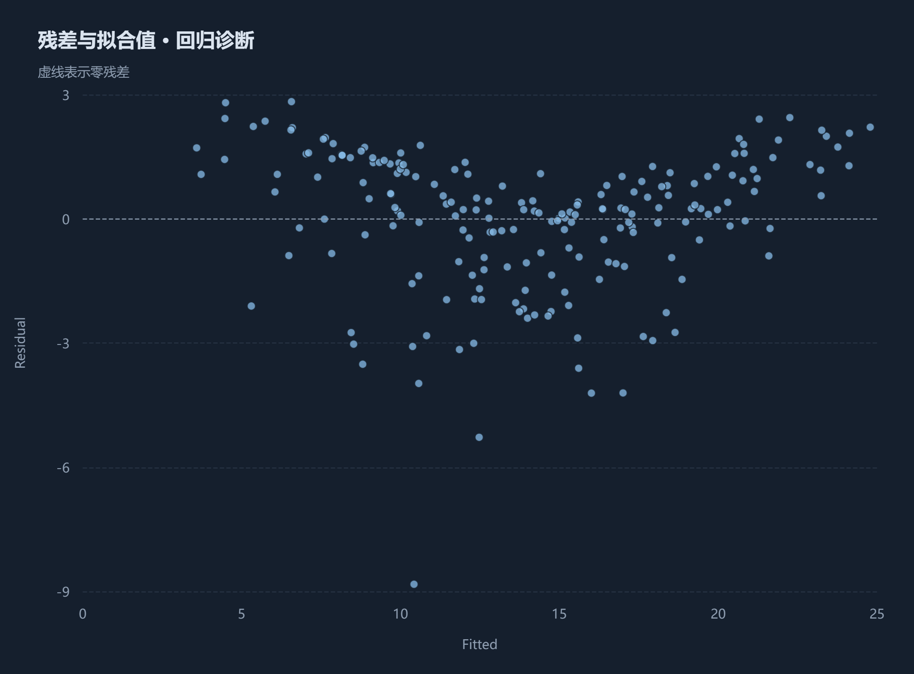
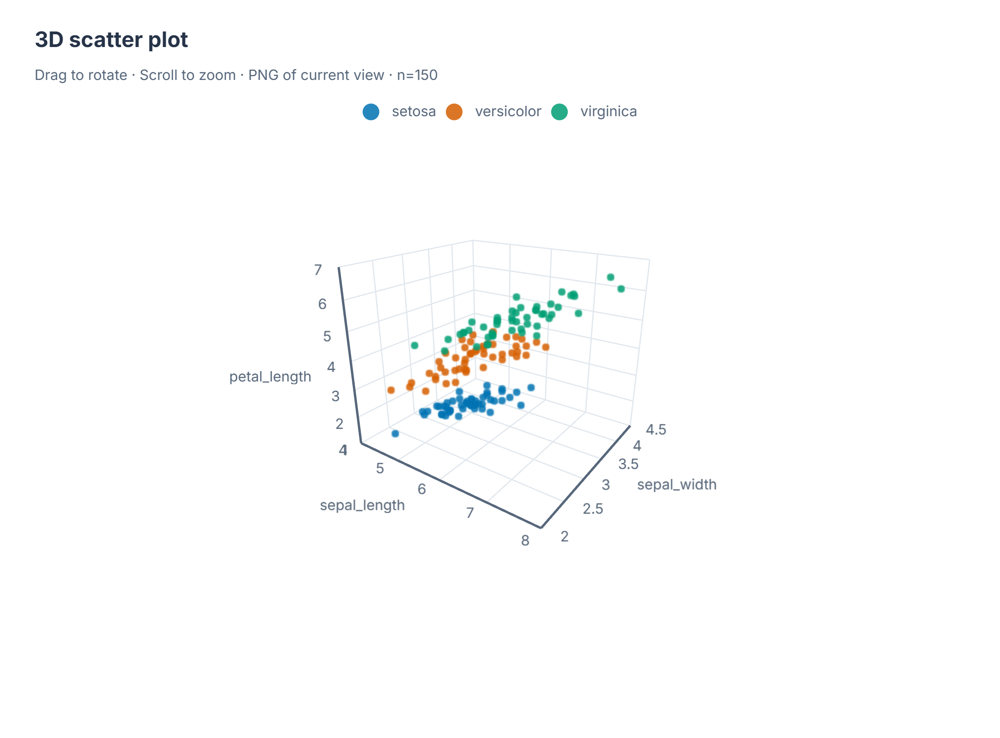

# StatM 功能实例 / Worked examples

[下载安装包 / Download](https://github.com/Lewis-18/StatM/releases/latest) · [中文介绍](README.md) · [English overview](README.en.md)

这里用内置 Advertising（200 条观测）与 Iris（150 条观测）数据展示 StatM 1.1.0 的分析和绘图操作。你可以按下面的步骤在应用中重现这些示例，并导出白色背景的图表。

Use the bundled Advertising (200 observations) and Iris (150 observations) datasets to try these analysis and plotting workflows in StatM 1.1.0. Follow the steps below to reproduce the examples and export figures with white backgrounds.

## 线性回归诊断 / Linear regression diagnostics

1. 在首页打开 Advertising 示例，进入“分析 → 线性回归”。
2. 选择 TV、radio、newspaper 为自变量，sales 为因变量，运行分析。
3. 查看系数表、置信区间、拟合指标、残差与正态 Q–Q 图。
4. 在图表工具栏导出 PNG、SVG 或 PDF；参数与结果可在历史中恢复。

Open Advertising, select TV/radio/newspaper as predictors and sales as the response, then run OLS. Review coefficients and diagnostics before interpreting the model. Use the residual and Q–Q plots to check model assumptions when interpreting the results.

## 三维数据探索 / Interactive 3D exploration

在“绘图”中选择三维散点图，以 sepal_length、sepal_width、petal_length 为三个坐标变量，按 species 分组。拖动旋转、滚轮缩放，比较变量关系；可切换图表背景并导出当前视角 PNG 或 PDF。

Use sepal_length, sepal_width and petal_length as the three axes, grouped by species. Rotate and zoom to inspect the observations, switch the chart background, and export the current view as PNG or PDF. Two-dimensional companion figures support PNG, SVG and PDF export.

## 历史结果对照 / Compare analysis results

1. 使用同一 Advertising 数据版本完成两次线性回归，例如先以 TV、radio 为自变量，再加入 newspaper；两次均以 sales 为因变量。
2. 进入历史页，先对基准记录点击“加入对照”，再加入第二条记录。
3. 并排查看参数、系数和拟合指标，可只看差异并导出对照 CSV。

对照要求同一数据版本、同一分析方法；假设检验还须为同一检验类型。差值用于描述结果变化，不构成显著性检验。

Fit two OLS models on the same Advertising dataset version, first using TV/radio and then adding newspaper, with sales as the response in both models. Add the baseline record and the second record to the comparison from History. Review parameters and statistics side by side, filter differences, and export CSV. Comparison requires the same dataset version and analysis method; hypothesis tests also require the same test type. Differences are descriptive and do not constitute a significance test.

## 散点框选与记录联动 / Link scatter selections to records

1. 用 Iris 新建三维散点图，并在“图表”页打开对应的二维投影。
2. 点击“框选记录”，在二维散点图中拖动矩形，查看对应记录表中的选择；也可直接勾选记录。
3. 可只看选中记录，或清除选择继续浏览；选择会保存并可恢复。

图中最多显示 2000 条均匀抽样记录，框选仅选择显示的点。原记录号在缺失值排除和抽样后可能不连续；选择不改变原有分析结果，也不会自动重新分析子集。旧图缺少记录身份字段时，可按原参数重跑启用联动。

Create a new Iris 3D scatter plot and open its 2D projection on the Charts page. Use the rectangular selection tool or select rows in the linked record table. Show selected records only or clear the selection to continue exploring; selections can be saved and restored. A plot displays at most 2,000 uniformly sampled records. Selection applies to displayed points and does not change saved analysis results or automatically analyze the subset. Rerun older plots to enable linking when record identity fields are missing.

## 科研图表导出 / Export publication figures

在图表底部选择 90 / 180 mm 科研单栏或双栏预设、白色或黑色背景及配色，再导出。二维图表支持 PNG/SVG/PDF；三维图表支持当前视角 PNG/PDF。桌面二维 PDF 保留矢量路径和文字，三维 PDF 使用当前视角的高分辨率位图；网页模式 PDF 为 300 DPI 位图。

Choose a 90 / 180 mm single-column or double-column preset, chart background and palette before exporting. Export 2D figures as PNG/SVG/PDF and the current 3D view as PNG/PDF. Desktop 2D PDFs retain vector paths and text; 3D PDFs contain a high-resolution image of the current view. Web-mode PDFs use a 300 DPI image.

## 从数据到结果 / From data to results

导入 CSV/TXT/Excel → 检查字段与缺失值 → 选择描述统计、相关、检验、回归或 PCA → 查看结果与诊断 → 导出图表和分析脚本 → 保存项目与历史。

Import CSV/TXT/Excel → inspect fields and missing values → select statistics, correlation, tests, regression or PCA → review results and diagnostics → export figures and analysis scripts → retain the project and history locally.

如果这些功能对你有帮助，欢迎为 [StatM](https://github.com/Lewis-18/StatM) 点 Star。问题与建议请通过 [Issues](https://github.com/Lewis-18/StatM/issues) 提交。

