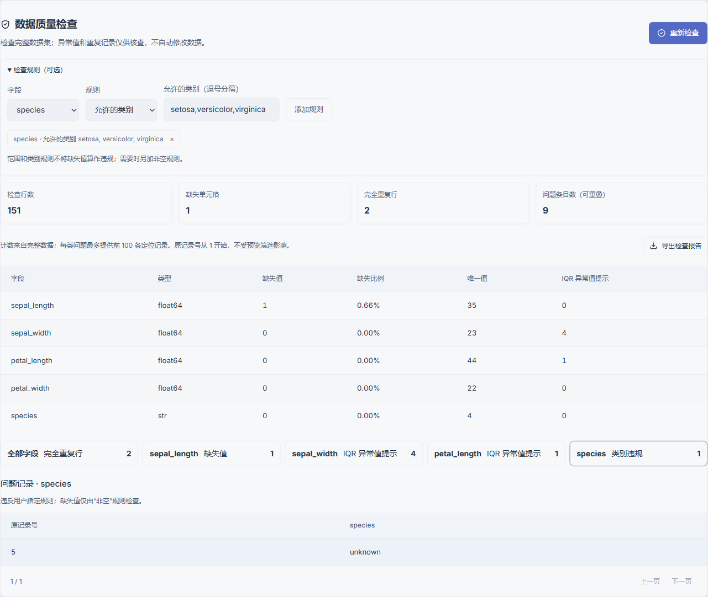
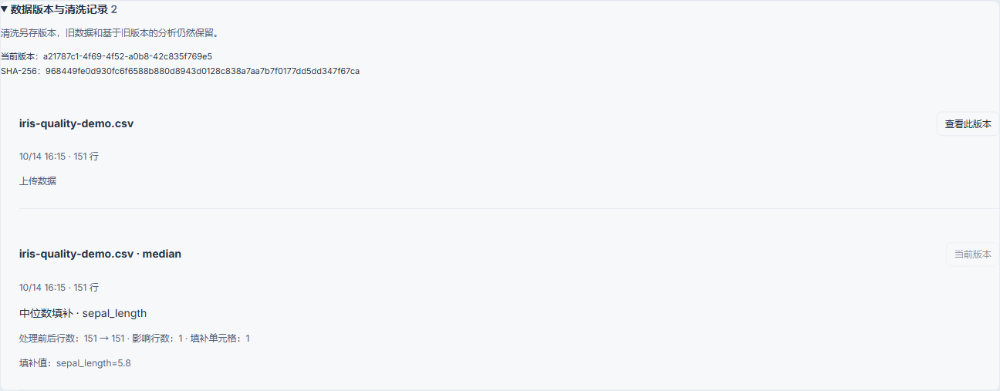
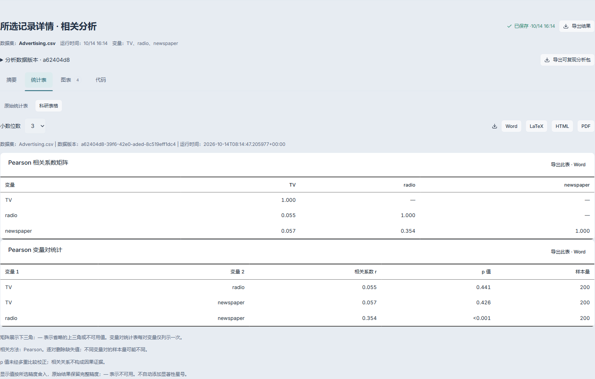
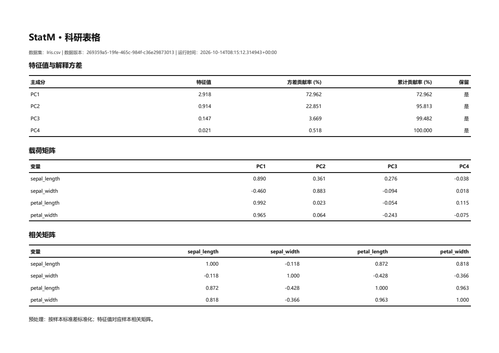
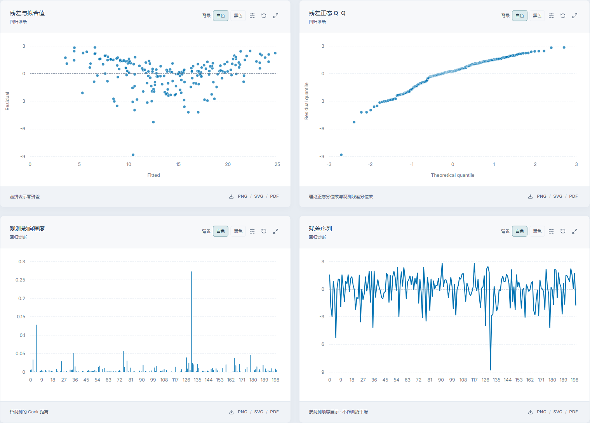
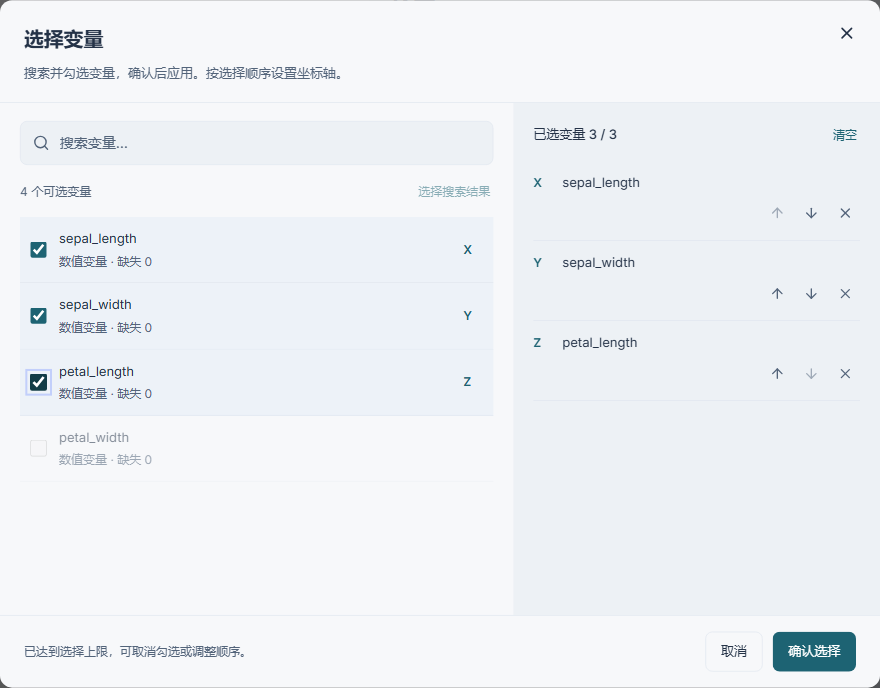
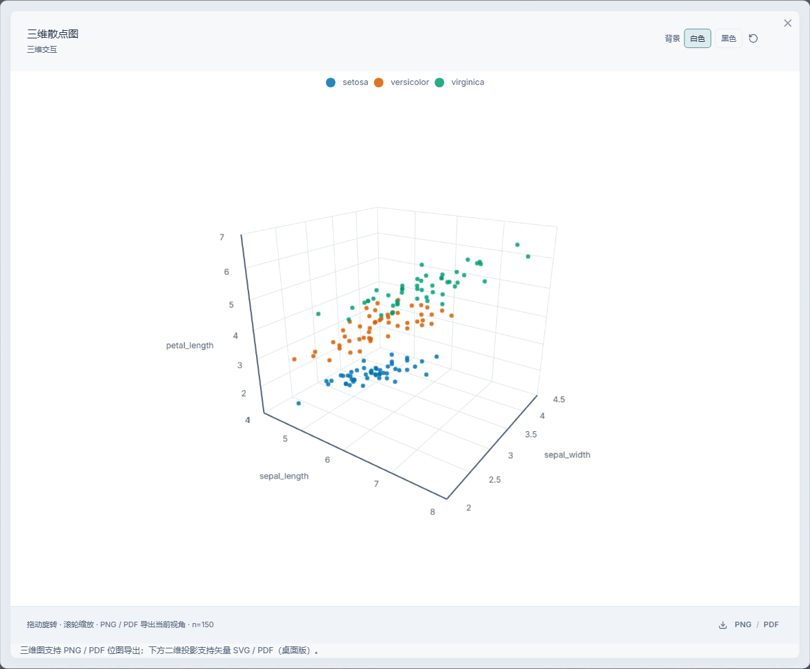
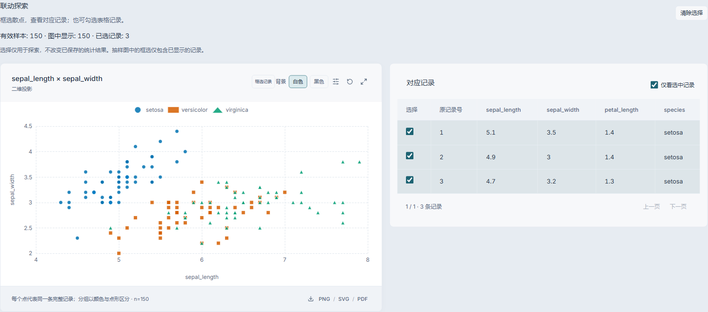
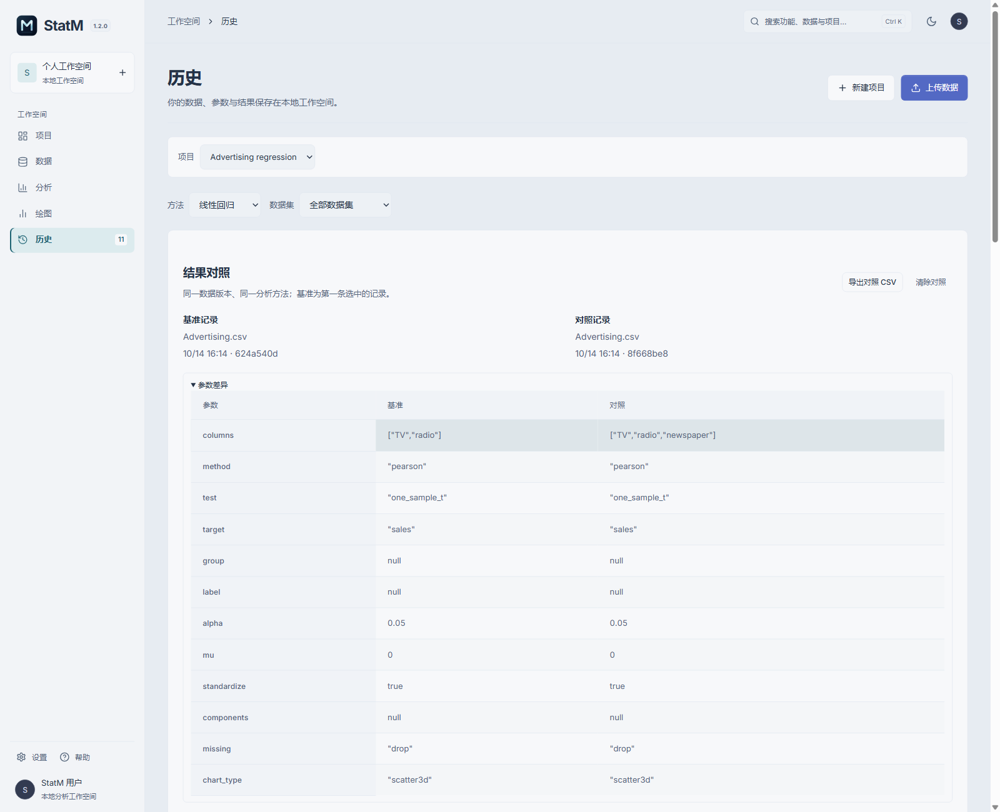
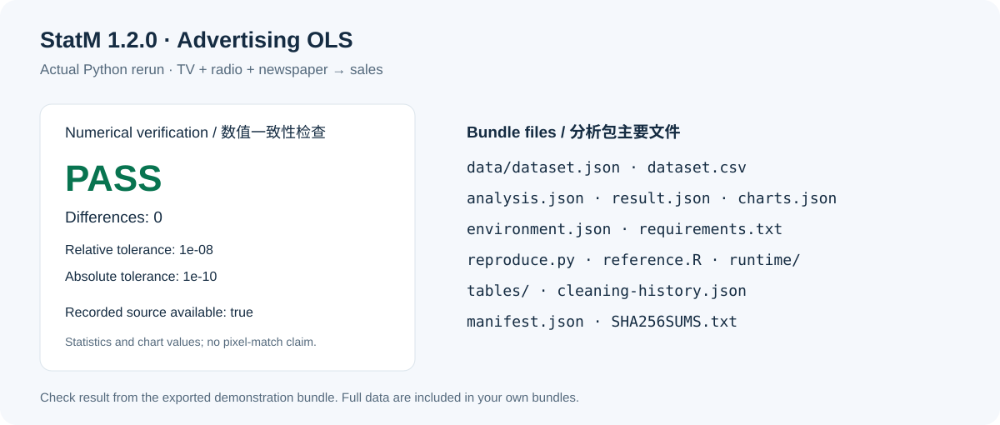

# StatM 图文示例

中文 · [English](EXAMPLES.en.md)

[下载 StatM](https://github.com/Lewis-18/StatM/releases/latest) · [使用指南](USER-GUIDE.md) · [首页](README.md) · [示例文件](samples/README.md)

以下步骤和截图来自 **StatM 1.2.0**。Advertising 有 200 条观测，Iris 有 150 条观测，可在应用首页直接加载。质量检查使用另行制作的教学异常数据，不代表原始 Iris 存在这些问题。

*界面截图来自补齐英文标签的本地 1.2.0 文档预览；当前已发布的 1.2.0 安装包仍可能显示少量中文标签。主要示例统一使用浅色应用主题与白底图表。*

## 数据质量与清洗版本

1. 下载 [iris-quality-demo.csv](samples/iris-quality-demo.csv)，创建项目并导入。
2. 打开「数据 → 质量检查」，展开规则，为 species 设置允许类别 setosa、versicolor、virginica，点击「运行检查」。
3. 查看完整数据的缺失、重复和 IQR 异常值提示，点击 species 类别违规卡片，定位第 5 条记录的 unknown。
4. 导出检查报告。进入「清洗」，仅选择 sepal_length 并用中位数填补，保存为独立版本。
5. 展开「数据版本与清洗记录」，查看父版本、填补值和影响数量；「查看此版本」可以返回原数据。

*教学数据共 151 行：清空原第 1 行的 sepal_length，将第 5 行 species 改为 unknown，将第 26 行 petal_length 改为 20，并追加原第 150 行。实际报告为 1 个缺失单元格、2 条完全重复行和 1 个类别违规。内置原副本已有 1 条完全重复行，教学修改另追加 1 条；IQR 提示数量以实际报告为准。问题类型可以重叠。*

质量检查不会自动删除或填补。IQR 标记需要结合领域知识判断；返回旧版本不删除后续版本。

## 科研统计表格

**Advertising 相关表格**

1. 打开 Advertising，选择「分析 → 相关分析」。
2. 勾选 TV、radio、newspaper，保持 Pearson 方法，运行。
3. 在「统计表」选择「科研表格」，设置小数位数，查看下三角相关矩阵和变量对统计表。
4. 导出 Word、LaTeX、HTML 或 PDF。

[Word](samples/advertising-correlation.docx) · [LaTeX](samples/advertising-correlation.tex) · [HTML](samples/advertising-correlation.html) · [PDF](samples/advertising-correlation.pdf)

**Iris PCA 表格**

打开 Iris，选择四个数值字段 sepal_length、sepal_width、petal_length、petal_width，运行 PCA。默认标准化下，查看特征值、方差贡献率、累计贡献率、载荷和相关矩阵；保留表下注明的标准化方式与载荷定义。

[Word](samples/iris-pca.docx) · [LaTeX](samples/iris-pca.tex) · [HTML](samples/iris-pca.html) · [PDF](samples/iris-pca.pdf)

显示精度不改变原始结果；小 p 值以阈值显示，不写成 0。相关分析未自动进行多重比较校正，相关关系不构成因果证据。

## 回归诊断

1. 打开 Advertising，选择「分析 → 线性回归」。
2. 以 TV、radio、newspaper 为自变量，sales 为因变量，运行。
3. 查看系数、置信区间、拟合统计与 VIF，再打开图表检查残差、正态 Q–Q、Cook 距离与残差序列。
4. 将图表背景设为白色，选择 90 / 180 mm 预设，导出。

残差的弯曲趋势和较大残差值得继续检查，不能仅凭拟合指标认定模型假设已满足。Cook 距离用于识别需核查的影响点，不是自动删除记录的依据。

[残差图 SVG](samples/regression-residuals.svg) · [残差图 PDF](samples/regression-residuals.pdf) · [回归表 Word](samples/advertising-regression.docx) · [回归表 PDF](samples/advertising-regression.pdf)

## 三维探索与变量选择

打开 Iris，在「绘图」选择三维散点图，按顺序选择 sepal_length、sepal_width、petal_length 为 X、Y、Z，以 species 分组。

运行后拖动旋转、滚轮缩放，或放大查看。当前三维视角支持 PNG/PDF 位图导出；配套二维投影支持 PNG/SVG/PDF。

三维图适合探索空间结构，比较细微差异时可结合二维投影。

## 散点与记录联动

1. 在新建的 Iris 三维图结果中打开「图表」，找到联动探索的二维投影。
2. 点击「框选记录」拖动矩形，或勾选对应记录表。
3. 查看选中点与原记录号；可以仅看选中记录或清除选择。

图中最多显示 2,000 条固定抽样记录，框选只选择显示的点。缺失排除和抽样会使原记录号不连续。选择可保存、恢复，但不会改变原结果或自动分析子集。旧图缺少记录身份字段时，可按原参数重跑。

## 历史结果对照

在同一 Advertising 数据版本上先以 TV、radio 预测 sales，再加入 newspaper。进入「历史」，先将两变量模型加入对照，再加入三变量模型，查看参数、系数和拟合指标，或导出对照 CSV。

[下载实际对照 CSV](samples/advertising-comparison.csv)

对照要求同一数据版本及分析方法；假设检验还须为同一检验类型。对照差值描述结果变化，不构成显著性检验。

## 可复现分析包

1. 在 Advertising 三变量回归的已保存结果旁点击「导出可复现分析包」。
2. 解压 ZIP，按 README.txt 与 environment.json 准备 Python 环境，安装 requirements.txt。
3. 运行 reproduce.py，查看 reproduction-check.json 的重算一致性结果。

[查看本次重算结果](samples/advertising-reproduction-check.json)

包中包含分析数据、参数、结果、图表数据与持久化设置、清洗来源、统计源码快照、依赖版本和校验清单。描述统计、假设检验、回归包还带科研表格。Python 重算比较统计与图表数值，容差见结果文件；R 为独立参考实现，不承诺像素级还原。上述检查结果来自实际运行的 Python 重算。

使用应用不要求另装 Python；运行外部复现脚本需要 Python 和依赖。分享你自己的分析包前，确认完整数据的共享范围。

## 导出建议

二维图用 SVG/PDF 保留矢量内容，三维图导出当前视角位图。选择白底或黑底、色盲友好配色与 90 / 180 mm 栏宽；PNG 为 300 DPI。投稿时以目标期刊要求为准。

反馈请通过 [Issues](https://github.com/Lewis-18/StatM/issues)，提供版本、步骤和脱敏截图。

© 2026 Jackson Lewis. StatM.

