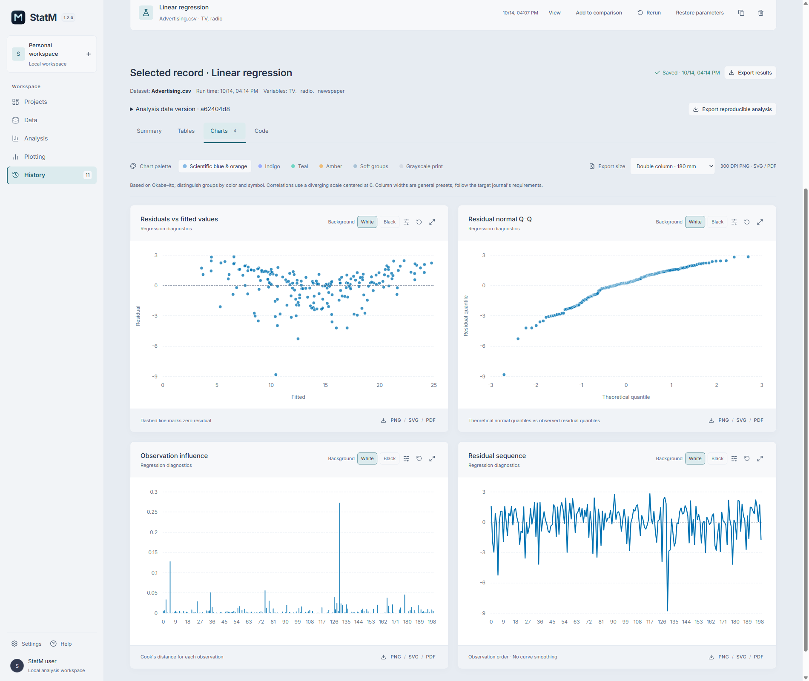

# StatM

[中文](README.md) · English

**From data to evidence.**

StatM is a Windows desktop application for statistical learning and research. Import and inspect data, run analyses, create research figures and tables, and retain reviewable analysis records in one local workspace.

**Version: 1.2.0** · **Windows x64** · **Maintainer: Jackson Lewis**

[Download](https://github.com/Lewis-18/StatM/releases/latest) · [User guide](USER-GUIDE.en.md) · [Worked examples](EXAMPLES.en.md) · [Release history](CHANGELOG.en.md) · [Report an issue](https://github.com/Lewis-18/StatM/issues)

*Screenshot: local 1.2.0 preview with language-display corrections. [Screenshot and installer details](EXAMPLES.en.md).*

## From data to results

- **Prepare**: import CSV, TXT and Excel; inspect fields, missing values, duplicates and outliers. Cleaning creates an independent dataset version with operation records.
- **Analyze**: descriptive statistics, correlation, hypothesis tests, OLS regression and PCA, with sample sizes, diagnostics, calculation notes and warnings.
- **Present**: export 2D/3D figures and editable research tables in Word, LaTeX, HTML and PDF.
- **Revisit and reproduce**: save parameters and history, compare compatible results, rerun on subsequent dataset versions, and export reproducible analysis bundles.

*An actual PDF export of Iris PCA eigenvalues, variance explained and loadings. [Download the sample](samples/iris-pca-en.pdf) · [Follow the example](EXAMPLES.en.md#research-tables)*

## Get started in three steps

1. Download the Windows x64 installer from the [latest release](https://github.com/Lewis-18/StatM/releases/latest), close any running copy, and install.
2. Create a project and import data, or open a built-in Iris or Advertising example.
3. Choose a method and variables, run the analysis, inspect the results, and export. See the [user guide](USER-GUIDE.en.md) for detailed instructions.

The installer includes the runtime. Routine data management, statistical analyses and figure export work offline, with no separate Python or Node.js installation. **Running a bundle's reproduction script outside the app requires Python and the dependencies listed in the bundle.**

Switch languages in **Settings → Language**. StatM remembers the preference. Dark/light themes and adjustable analysis panels are also available.

## Analysis and visualization

| Task | Tools |
| --- | --- |
| Data management | CSV/TXT/XLSX/XLS; searchable previews, field inspection, missing-value handling, duplicate removal, quality rules and dataset lineage |
| Descriptive statistics | Summary measures, histograms, box plots, density curves, ECDF and normal Q–Q plots |
| Correlation | Pearson, Spearman and Kendall; heatmaps, scatterplot matrices, research correlation matrices and pairwise statistics |
| Hypothesis tests | One-sample, independent and paired t-tests; Wilcoxon, Mann–Whitney U, chi-square, ANOVA and Kruskal–Wallis |
| Regression and PCA | OLS estimates, confidence intervals, VIF, residual and influence diagnostics; PCA eigenvalues, variance explained, scores and loadings |
| Scientific visualization | 2D/3D scatter plots, bubbles, parallel coordinates, scatterplot matrices, grouped box plots and category counts; linked scatter records |
| Export and reproduction | CSV/JSON; Word/LaTeX/HTML/PDF research tables; 2D PNG/SVG/PDF; current 3D view PNG/PDF; Python/R scripts and analysis bundles |

## Local storage and updates

Project data and computations stay on your computer. Update checks access GitHub; offline analysis remains available. Close the app before updating, install to the same directory, and retain the existing local workspace.

The installer is currently unsigned. The release includes SHA256SUMS.txt for download-integrity checks. See [installation and data storage](USER-GUIDE.en.md#updates-and-local-data) for details.

Please report issues with the version, reproduction steps and anonymized screenshots through [Issues](https://github.com/Lewis-18/StatM/issues). Star the repository to follow the project.

© 2026 Jackson Lewis. StatM.

