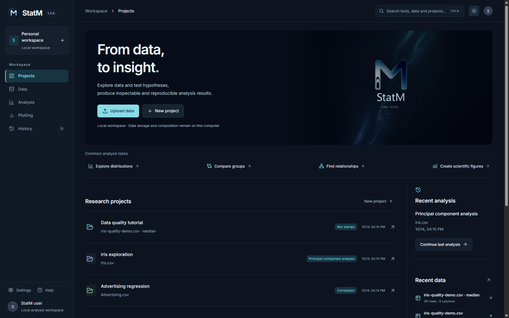
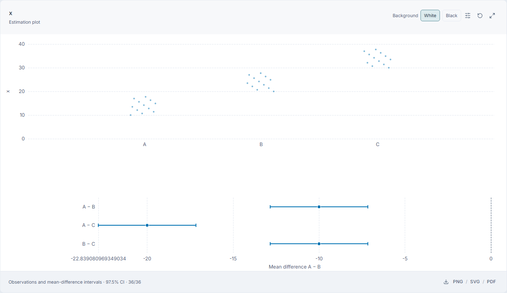

# StatM

[中文](README.md) · English

**From data to insight.**

StatM is a Windows desktop application for statistics learning and research. Prepare data, run statistical analyses, produce scientific figures and tables, and retain reviewable analysis records in a local workspace.

**Version: 1.3.0** · **Windows x64** · **Maintainer: Jackson Lewis**

[Download](https://github.com/Lewis-18/StatM/releases/latest) · [User guide](USER-GUIDE.en.md) · [Worked examples](EXAMPLES.en.md) · [Changelog](CHANGELOG.en.md) · [Report an issue](https://github.com/Lewis-18/StatM/issues)

View dark theme

## New in 1.3.0

- **Excel worksheet selection**: preview the first 10 rows before importing a selected sheet; retain text identifiers and worksheet provenance.
- **Quality rule library**: save, load and manage rule sets, with field compatibility checks.
- **Post-hoc comparisons**: Tukey–Kramer for ANOVA, Games–Howell for Welch ANOVA, and Dunn–Holm for Kruskal–Wallis, including all pairs and adjusted p values.
- **Estimation plots**: show observations and mean differences with confidence intervals in the original units; retain paired connections.
- **Variable dictionaries**: maintain labels, units, descriptions and code meanings, inherited by cleaned versions and frozen when an analysis runs.
- **Dataset joins**: check multi-key left, inner and full joins within a project before saving a separate dataset.
- **Multi-panel figures**: combine saved 2D figures into two panels or a 2×2 layout, exporting SVG, 300 DPI PNG, PDF and configuration.
- **Analysis bundle inventory**: inspect the scope of complete data, dictionaries, provenance, cleaning history, results and reproduction source before export.

*Synthetic teaching data illustrate mean differences and 97.5% confidence intervals; research tables retain the complete results. [Walkthrough](EXAMPLES.en.md#post-hoc-comparisons-and-estimation-plots) · [PDF sample](samples/v1.3.0/estimation.pdf)*

## Get started

1. Download the Windows x64 installer from the [latest release](https://github.com/Lewis-18/StatM/releases/latest), close StatM and install.
2. Create a project and import data, or load a built-in example such as Iris or Advertising. Preview and select an Excel worksheet before import.
3. Choose a method and variables, inspect sample sizes, assumptions and warnings, then export.

The runtime is included and core functions work offline, without a separate Python or Node.js installation. Running reproduction scripts outside the app requires Python and the dependencies listed in the bundle. Switch Chinese or English in Settings → Language; light/dark themes and resizable analysis panels are available.

## Analyses and figures

| Task | Capabilities |
| --- | --- |
| Data preparation | CSV/TXT/XLSX/XLS, worksheet selection, search/sort, cleaning versions, quality rules and libraries, variable dictionaries, multi-key joins |
| Descriptive statistics | Means, standard deviations, quantiles; histograms, box plots, density curves, ECDF and normal Q–Q plots |
| Correlation | Pearson, Spearman, Kendall; heatmaps, scatter matrices, coefficient matrices and pairwise tables |
| Hypothesis tests | One-sample, independent Welch and paired t; Wilcoxon, Mann–Whitney U, chi-square, ANOVA, Welch ANOVA, Kruskal–Wallis; corresponding post-hoc comparisons and estimation plots |
| Regression and PCA | OLS coefficients, confidence intervals, VIF, residual and influence diagnostics; PCA eigenvalues, explained variance, scores and loadings |
| Scientific figures | 2D/3D scatter, bubble, parallel coordinates, scatter matrices, grouped box plots, category counts, linked records, two-panel and 2×2 compositions |
| Export and reproduction | CSV/JSON, research tables as Word/LaTeX/HTML/PDF, 2D PNG/SVG/PDF, current-view 3D PNG/PDF, Python/R reference code, reproducible analysis bundles |

## Local storage and updates

Project data and core computation stay on the local machine. Update checks access GitHub. Close the app before installing into the existing directory; local workspaces are retained. The installer is unsigned; SHA256SUMS.txt is supplied on the release page.

This repository provides releases, documentation and [selected open components and statistical tools](open-source/README.en.md). The complete application is distributed through the Windows installer. Include the version, reproduction steps and de-identified screenshots when [reporting an issue](https://github.com/Lewis-18/StatM/issues).

© 2026 Jackson Lewis. StatM.
