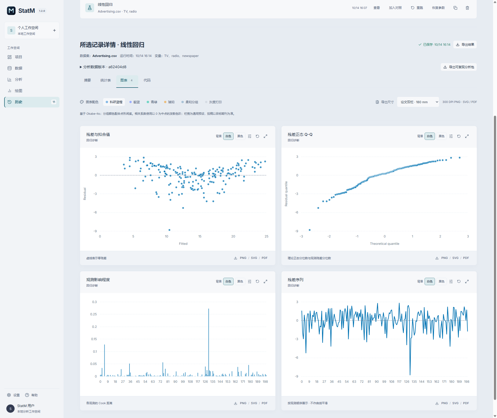
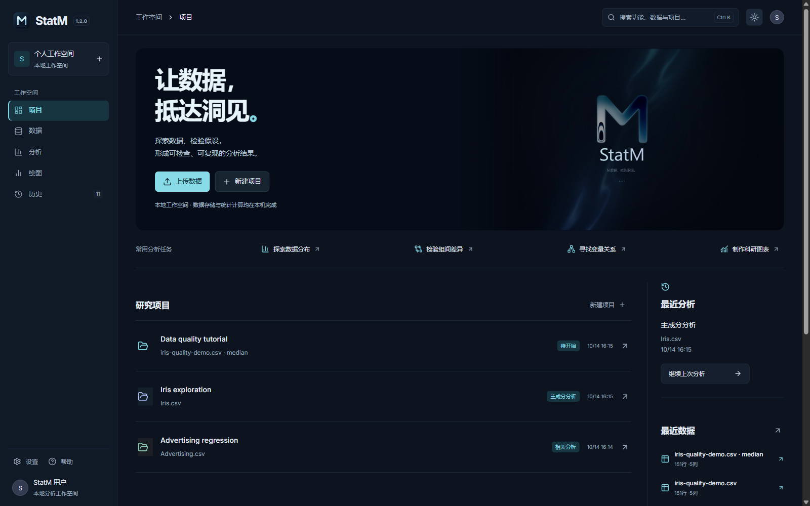
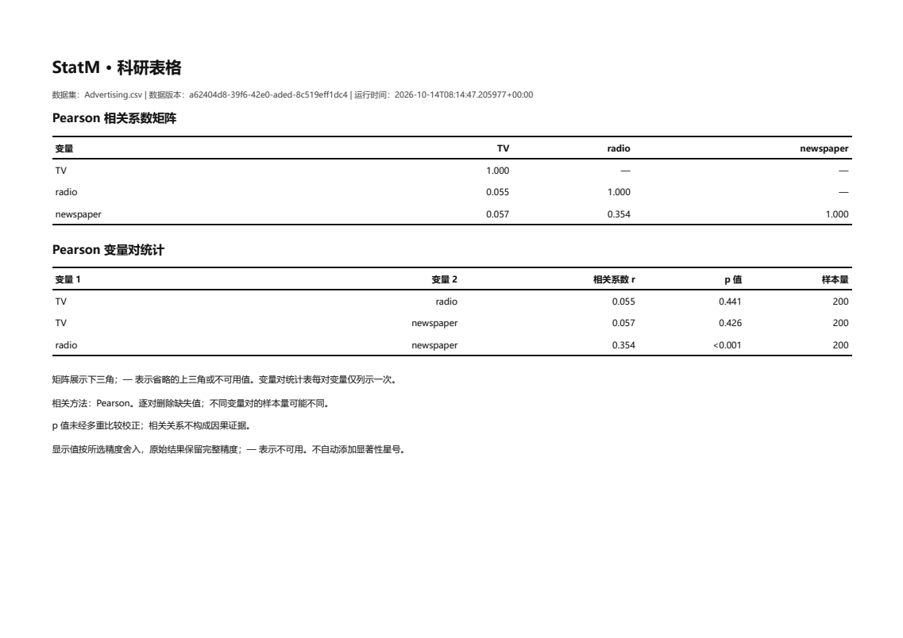

# StatM

中文 · [English](README.en.md)

**让数据，抵达洞见。**

StatM 是面向统计学习与科研的 Windows 桌面应用。在一个本地工作空间中导入和检查数据、完成统计分析、制作科研图表与表格，并保存可复查的分析记录。

**版本：1.2.0** · **Windows x64** · **维护者：Jackson Lewis**

[下载安装包](https://github.com/Lewis-18/StatM/releases/latest) · [使用指南](USER-GUIDE.md) · [图文示例](EXAMPLES.md) · [更新记录](CHANGELOG.md) · [问题反馈](https://github.com/Lewis-18/StatM/issues)

查看深色主题

*截图为含语言显示修正的本地 1.2.0 预览。[截图与安装包说明](EXAMPLES.md)。*

## 从数据到结果

- **整理数据**：导入 CSV、TXT、Excel，检查字段、缺失值、重复记录和异常值；清洗生成独立版本，保留来源与操作记录。
- **完成分析**：描述统计、相关分析、假设检验、OLS 回归与 PCA；查看样本量、诊断图、计算说明和警告。
- **呈现成果**：制作二维与三维图，导出 PNG/SVG/PDF；科研表格可导出为可编辑 Word、LaTeX、HTML 和 PDF。
- **回看与复现**：保存参数及历史，对照兼容结果，基于后续数据版本重跑，并导出可复现分析包。

*使用内置 Advertising 数据导出的相关矩阵与变量对统计表。[下载样例](samples/advertising-correlation.pdf) · [查看完整示例](EXAMPLES.md#科研统计表格)*

## 三步开始

1. 从 [最新发布页](https://github.com/Lewis-18/StatM/releases/latest) 下载 Windows x64 安装包，关闭已运行的 StatM 后安装。
2. 创建项目并导入数据，或在首页点击 Iris、Advertising 等内置示例。
3. 选择分析方法与变量，运行后检查结果并导出。完整步骤见 [使用指南](USER-GUIDE.md)。

安装包内置运行环境，常规数据管理、统计分析与图表导出可离线使用，无需另行安装 Python 或 Node.js。**在应用外运行复现包中的脚本，需要按包内说明准备 Python 与依赖。**

在「设置 → 语言」中切换中文或 English，应用会记住偏好。界面也支持深浅主题和可调整的分析面板。

## 支持的分析与绘图

| 工作 | 内容 |
| --- | --- |
| 数据管理 | CSV/TXT/XLSX/XLS、搜索与排序、字段检查、缺失处理、去重、质量规则、版本与清洗记录 |
| 描述统计 | 均值、标准差、分位数等；直方图、箱线图、密度图、ECDF、正态 Q–Q 图 |
| 相关分析 | Pearson、Spearman、Kendall；热图、散点矩阵、相关矩阵与变量对统计表 |
| 假设检验 | 单样本、独立样本及配对 t 检验；Wilcoxon、Mann–Whitney U、卡方、ANOVA、Kruskal–Wallis |
| 回归与 PCA | OLS 系数与置信区间、VIF、残差与影响点诊断；PCA 特征值、贡献率、得分与载荷 |
| 科学可视化 | 二维与三维散点、气泡、平行坐标、散点矩阵、分组箱线和类别频数图；散点与记录联动 |
| 导出与复现 | CSV/JSON、科研表格 Word/LaTeX/HTML/PDF、二维 PNG/SVG/PDF、三维当前视角 PNG/PDF、Python/R 脚本、分析包 |

## 本地保存与更新

项目数据和统计计算保留在本机。更新检查需要访问 GitHub；断网时仍可继续本地分析。更新前关闭应用，安装到原目录，已有本地工作空间沿用。

安装包目前未进行数字签名；发布页提供 SHA256SUMS.txt，可用于校验下载完整性。安装说明和数据保存建议见 [使用指南](USER-GUIDE.md#更新与本地数据)。

欢迎通过 [Issues](https://github.com/Lewis-18/StatM/issues) 提交问题或建议，附上版本、复现步骤和脱敏截图。如果 StatM 对你有帮助，欢迎为仓库点 Star。

© 2026 Jackson Lewis. StatM.

