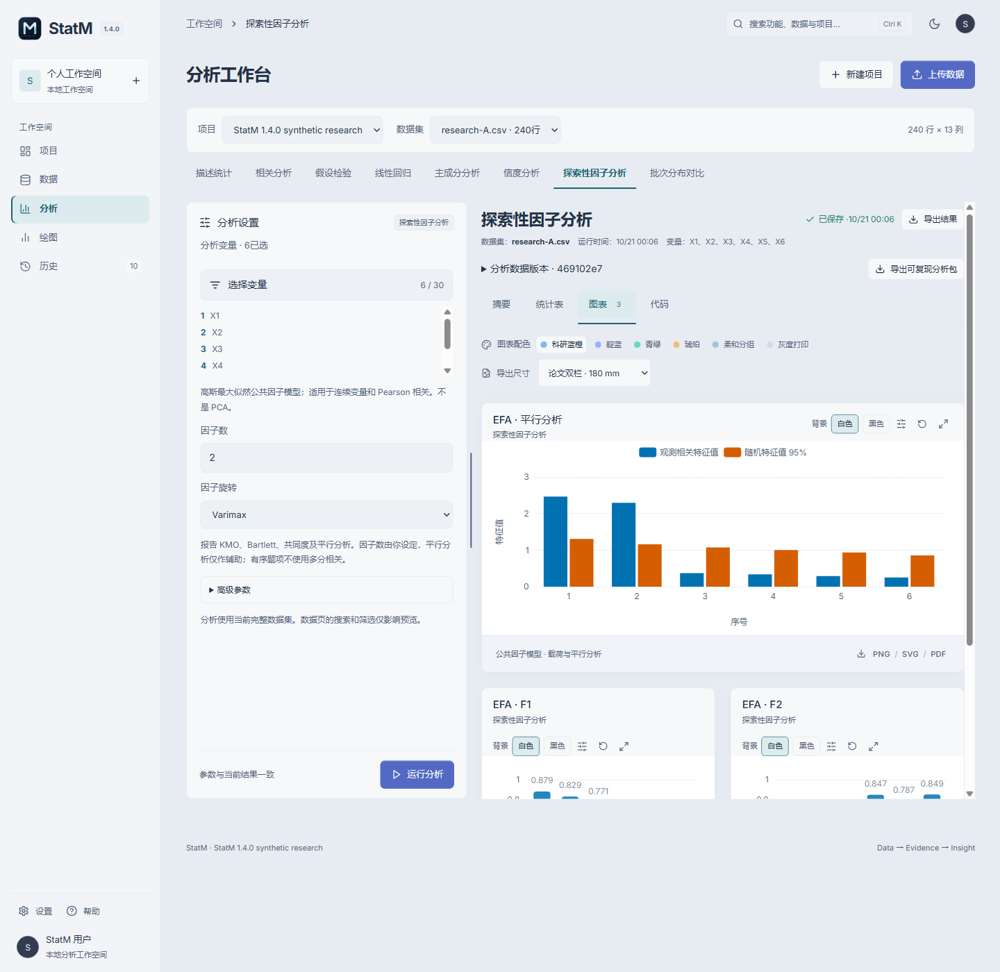
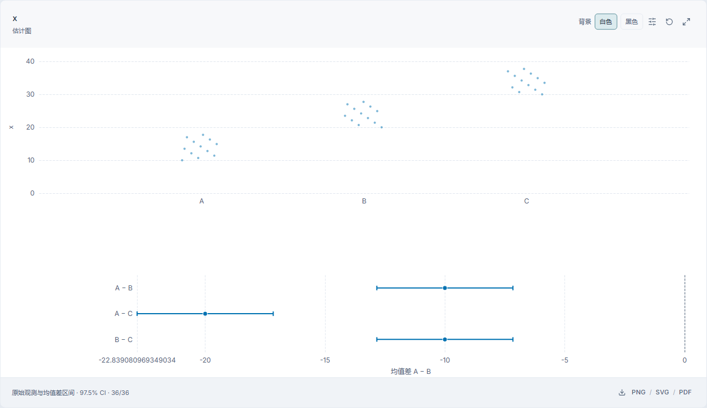

# StatM

中文 · [English](README.en.md)

**让数据，抵达洞见。**

StatM 是面向统计学习与科研的 Windows 桌面应用。在本地工作空间中整理数据、完成统计分析、制作科研图表与表格，并保存可复查的分析记录。

**版本：1.4.0** · **Windows x64** · **维护者：Jackson Lewis**

[下载安装包](https://github.com/Lewis-18/StatM/releases/latest) · [使用指南](USER-GUIDE.md) · [图文示例](EXAMPLES.md) · [更新记录](CHANGELOG.md) · [问题反馈](https://github.com/Lewis-18/StatM/issues)

查看深色主题

## 1.4.0 新增功能

- **问卷信度分析**：Cronbach’s α、Feldt 置信区间、校正题总相关与删题后的 α，显式设置反向题及计分范围。
- **探索性因子分析 EFA**：最大似然公共因子模型、不旋转或 Varimax，报告 KMO、Bartlett、载荷、共同度、独特方差和平行分析。
- **通用分面**：散点图和直方图按组分面，共用坐标范围与分箱，列示各组完整样本量及显示数量。
- **批次分布对比**：逐项映射两批字段，核对单位和编码，比较样本量、缺失率、数值分布与类别占比。
- **测量尺度与研究设计**：字典增加名义、有序、连续尺度；假设检验明确独立与配对设计。
- **启动页修复**：中英文页脚读取应用实际版本，保留既有开场与等待动画。

α 不证明单维性或效度，不自动删题。EFA 不计算多分相关或 CFA，因子数由用户设定，平行分析仅作辅助。批次对比为描述性结果，不计算独立样本检验 p 值，不跨量纲排名；缺失值处理和单位编码需结合研究口径判断。

[新增功能图文示例](EXAMPLES.md) · [方法与验证](METHODS.md)

## 1.3.0 新增功能

- **Excel 工作表选择**：查看工作表及前 10 行，再导入所选工作表；保留文本编号的前导零和工作表来源。
- **数据质量规则库**：保存、加载和管理规则集，加载时检查字段兼容性。
- **事后比较**：ANOVA 配套 Tukey–Kramer，Welch ANOVA 配套 Games–Howell，Kruskal–Wallis 配套 Dunn–Holm，列示全部组对及校正后的 p 值。
- **估计图**：展示原始观测、原始量纲的均值差及置信区间，配对数据保留连接。
- **变量字典**：维护字段标签、单位、说明和编码含义，清洗版本继承，分析保存运行时快照。
- **数据集关联**：支持同项目多键左关联、内关联和全关联，先检查匹配关系与输出规模，再保存新数据集。
- **多面板组合图**：选择已保存的二维图表，组成横向双图或 2×2，导出 SVG、300 DPI PNG、PDF 及配置。
- **分析包内容提示**：导出前列明完整数据、变量字典、来源、清洗历史、结果与复现源码的范围。

*使用合成教学数据展示均值差及 97.5% 置信区间；完整统计结果见科研表格。[图文步骤](EXAMPLES.md#事后比较与估计图) · [PDF 样例](samples/v1.3.0/estimation.pdf)*

## 三步开始

1. 从 [最新发布页](https://github.com/Lewis-18/StatM/releases/latest) 下载 Windows x64 安装包，关闭已运行的 StatM 后安装。
2. 创建项目并导入数据，或在首页加载 Iris、Advertising 等内置示例；Excel 可先预览并选择工作表。
3. 选择分析方法与变量，检查样本量、统计假设与警告，再导出结果。

安装包内置运行环境，核心功能可离线使用，无需另装 Python 或 Node.js。在应用外运行复现脚本，需按分析包说明准备 Python 与依赖。在「设置 → 语言」切换中文或 English；支持深浅主题及可调整的分析面板。

## 支持的分析与绘图

| 工作 | 内容 |
| --- | --- |
| 数据准备 | CSV/TXT/XLSX/XLS、Excel 选表、搜索与排序、清洗版本、质量检查与规则库、变量字典、多键关联 |
| 描述统计 | 均值、标准差、分位数；直方图、箱线图、密度图、ECDF、正态 Q–Q 图 |
| 相关分析 | Pearson、Spearman、Kendall；热图、散点矩阵、相关矩阵与变量对统计表 |
| 假设检验 | 单样本、Welch 独立样本及配对 t；Wilcoxon、Mann–Whitney U、卡方、ANOVA、Welch ANOVA、Kruskal–Wallis；配套事后比较与估计图 |
| 回归与 PCA | OLS 系数、置信区间、VIF、残差与影响点诊断；PCA 特征值、贡献率、得分与载荷 |
| 科学可视化 | 二维与三维散点、气泡、平行坐标、散点矩阵、分组箱线、类别频数、散点与记录联动、双图与 2×2 组合 |
| 导出与复现 | CSV/JSON、科研表格 Word/LaTeX/HTML/PDF、二维 PNG/SVG/PDF、三维当前视角 PNG/PDF、Python/R 参考代码、可复现分析包 |

## 本地保存与更新

项目数据与核心计算保留在本机，更新检查需要访问 GitHub。关闭应用后安装到原目录，已有本地工作空间沿用。安装包未数字签名；发布页提供 SHA256SUMS.txt。

公开仓库提供发行文件、文档和 [部分开源组件与统计工具](open-source/README.md)，完整应用通过 Windows 安装包提供。[反馈问题或建议](https://github.com/Lewis-18/StatM/issues) 时请附上版本、复现步骤和脱敏截图。

© 2026 Jackson Lewis. StatM.
