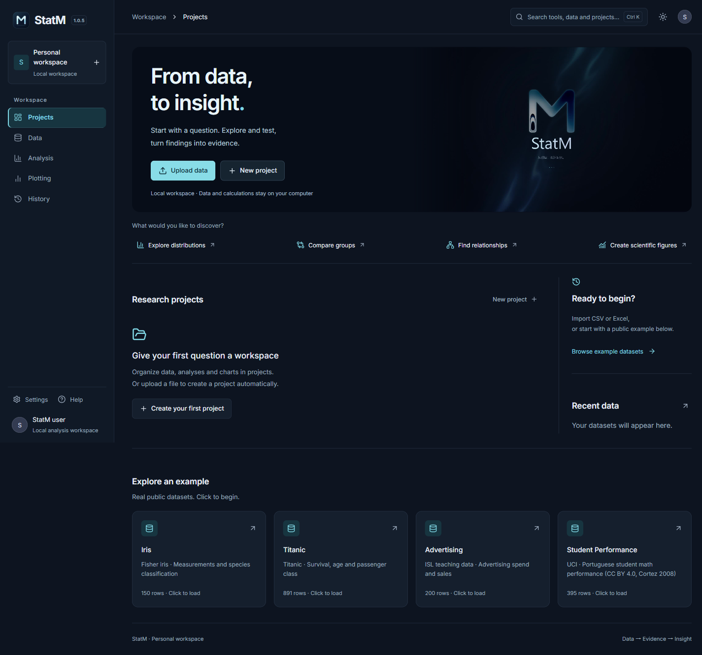
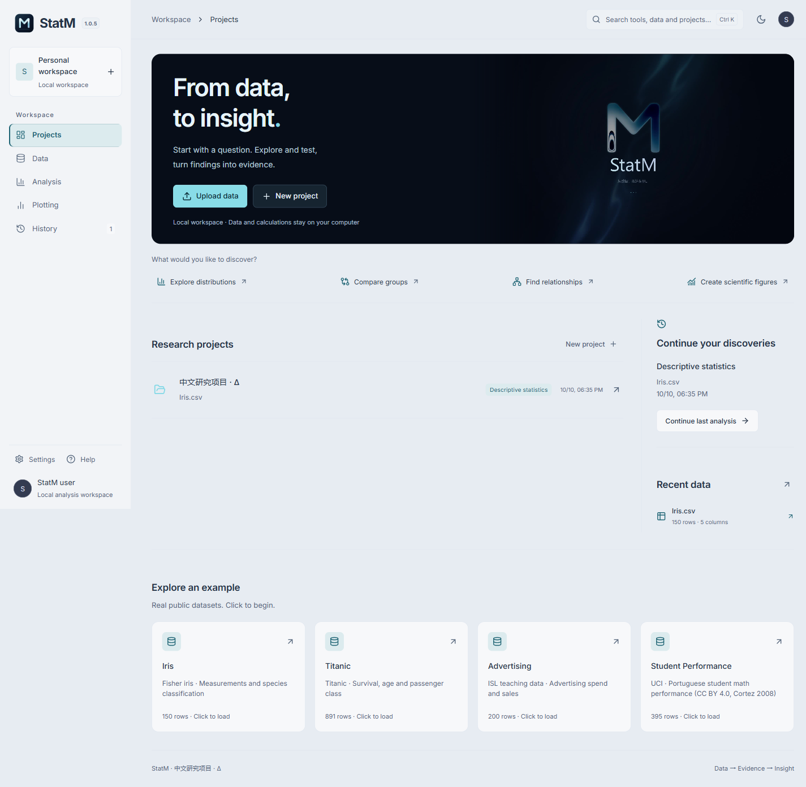

# StatM

中文 · [English](README.en.md)

**让数据，抵达洞见。**

StatM 是面向学习与科研的 Windows 桌面统计分析与科学可视化应用。它将数据管理、统计计算、科研绘图和分析记录整合在同一个工作空间，帮助用户完成从原始数据到研究结果的分析过程。

> **English summary:** StatM is an offline Windows desktop application for statistical analysis and scientific visualization: CSV/Excel import, exploratory data analysis, hypothesis testing, OLS regression, PCA, and PNG/SVG export. [Read the English overview](README.en.md).

**版本：1.0.5** · **平台：Windows x64** · **维护者：Jackson Lewis**

[下载安装包](https://github.com/Lewis-18/StatM/releases/download/v1.0.5/StatM-Setup-1.0.5-x64.exe) · [版本发布](https://github.com/Lewis-18/StatM/releases/latest) · [使用指南](USER-GUIDE.md) · [功能实例](EXAMPLES.md) · [问题反馈](https://github.com/Lewis-18/StatM/issues)

## 1.0.5 更新

- 正式版封面与统一版本标识，直接进入工作台。
- 优化启动与历史恢复，计算组件后台预备，图表模块按需加载。
- 设置中提供中文 / English 切换，记住应用语言偏好。
- 改进复制反馈、加载占位、键盘焦点和设置开关。
- 科研图表实例统一采用白色背景，便于阅读和交流。

## 适用场景

- **统计学习与课程实践**：通过内置示例理解描述统计、假设检验、回归与 PCA。
- **科研数据探索**：检查数据分布、变量相关性和模型诊断，整理分析结果。
- **科研绘图与结果交流**：导出 PNG/SVG 图表、统计表及分析脚本。

查看 [实际图表与操作示例](EXAMPLES.md)，或直接下载 Windows 安装包体验。

## 主要功能

| 功能 | 内容 |
| --- | --- |
| 数据管理 | 导入 CSV、XLSX、XLS；数据预览、搜索、排序、字段筛选与类型检查；缺失值处理及去重，生成新的清洗数据版本。 |
| 描述统计 | 样本量、均值、标准差、分位数、偏度、峰度等指标；直方图、箱线图、密度图、ECDF 与正态 Q–Q 图。 |
| 相关分析 | Pearson、Spearman、Kendall 相关系数与显著性结果；相关热图和散点矩阵。 |
| 假设检验 | 单样本、独立样本及配对 t 检验；Wilcoxon、Mann–Whitney U、卡方、单因素 ANOVA 与 Kruskal–Wallis。 |
| 线性回归 | OLS 系数、置信区间与拟合指标；残差、Q–Q、Cook 距离等诊断图，提供 VIF 与模型假设检查。 |
| 主成分分析 | 中心化与标准化、解释方差、碎石图、样本得分图及载荷图。 |
| 科学可视化 | 三维散点、气泡、平行坐标、散点矩阵、分组箱线与类别频数图；独立图表背景和科研导出预设。 |
| 项目与历史 | 本地保存项目、数据集、参数草稿、分析结果和图表；支持恢复参数、复制记录和重新分析。 |
| 结果导出 | 统计表 CSV、结果 JSON、二维图表 PNG/SVG、三维当前视角 PNG，以及 Python/R 分析脚本。 |

## 本地运行，连续工作

核心计算与项目数据保留在用户电脑上。安装包内置运行环境，无需另行安装 Python 或 Node.js，断网时也可使用数据导入、统计分析与图表导出。版本检查通过官方静态版本信息与 GitHub 发布页获取更新，缓存与冷却机制减少重复请求。

工作台支持 **中文 / English 即时切换**、深色与浅色主题、可调整宽度的分析面板、变量搜索和快捷导航。首页提供数据导入、常用统计任务、最近项目与继续分析入口；参数草稿与分析历史可在重新启动后恢复。

*界面预览使用示例工作空间。*

## 下载与安装

1. 下载 [StatM 1.0.5 Windows x64 安装包](https://github.com/Lewis-18/StatM/releases/download/v1.0.5/StatM-Setup-1.0.5-x64.exe)。
2. 运行安装程序并选择安装目录。
3. 启动 StatM，创建项目后导入数据或打开内置示例。

安装与更新前请关闭正在运行的应用。发布页提供 SHA-256 校验文件；当前安装包未进行数字签名，Windows 可能显示发布者提示。

更多操作见 [使用指南](USER-GUIDE.md)，版本变化见 [更新记录](CHANGELOG.md)。

## 反馈与建议

欢迎通过 [Issues](https://github.com/Lewis-18/StatM/issues) 提交使用问题和功能建议。请提供版本、操作步骤与脱敏截图，以便定位问题。

如果 StatM 对你有帮助，欢迎点击仓库右上角的 **Star**，帮助更多学习者与科研用户发现它。

© 2026 Jackson Lewis. StatM.

